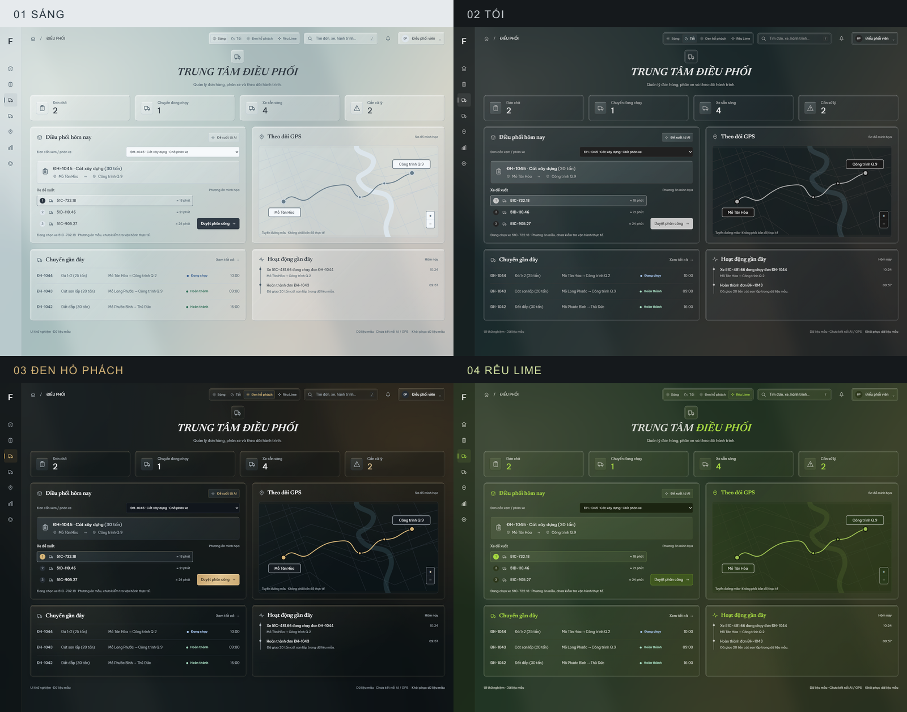

# Fleet Autopilot

Giao diện quản lý điều phối vận chuyển vật liệu: tiếp nhận đơn hàng, phân xe và theo dõi quá trình thực hiện trong một không gian làm việc thống nhất.

> **Kho UI chuẩn đã chốt.** Giao diện và bốn nền là chuẩn để phát triển các trang tiếp theo. Các thao tác hiện sử dụng dữ liệu mẫu lưu trên trình duyệt; chưa kết nối backend, AI, GPS thực tế, đăng nhập hoặc phân quyền.



## UI chuẩn đã chốt

Hình thức và cả bốn nền được chốt ngày 16/11/2026 làm chuẩn cho các trang tiếp theo. Xem [tài liệu UI chuẩn](UI_STANDARD.md) và [bộ ảnh bốn nền](docs/ui-standard/2026-11-16/four-themes.png). Kế thừa font, màu, lớp kính và thành phần hiện có khi thêm trang; các thay đổi thiết kế cần ảnh xem trước được duyệt.

## Tính năng

| Màn hình | Chức năng trong bản thử |
| --- | --- |
| Tổng quan | Số liệu vận hành, đơn cần xử lý, cảnh báo và hoạt động gần đây. |
| Đơn hàng | Tạo/sửa đơn chờ, tìm kiếm không dấu, lọc trạng thái và ngày, xem chi tiết, hủy mẫu và xuất CSV. |
| Điều phối | Chọn đơn và xe, xem trước phân công, bắt đầu và hoàn thành chuyến mẫu. |
| Xe & tài xế | Hai danh sách liên kết, thêm/sửa, lọc và xuất CSV từng danh sách. |
| GPS | Chọn xe, lọc tín hiệu, phóng to sơ đồ và cập nhật vị trí mô phỏng. |
| Báo cáo | Tổng hợp số đơn, khối lượng đã giao và tỷ lệ hoàn thành theo khoảng ngày; biểu đồ và xuất CSV. |

## Chạy trên máy cá nhân

Dự án sử dụng HTML, CSS và JavaScript thuần, không cần cài thư viện hoặc chạy bước build.

Mở terminal tại thư mục `UI`, chạy lệnh dưới đây. Máy cần Node/npm và Python 3; không cần `npm install`:

```bash
npm run dev
```

Mở [System Admin — Đen hổ phách](http://localhost:8083/?role=admin_system&theme=amber) hoặc [Điều phối — Đen hổ phách](http://localhost:8083/?role=dispatch&theme=amber). Giữ terminal mở; nhấn `Ctrl+C` để dừng.

Hoặc khởi động trực tiếp bằng Python 3:

```bash
python -m http.server 8083 --bind 127.0.0.1
```

Nếu máy dùng lệnh `python3`:

```bash
python3 -m http.server 8083 --bind 127.0.0.1
```

Mở [trang Tổng quan](http://127.0.0.1:8083/?page=overview) trên trình duyệt. Nhấn `Ctrl+C` trong terminal để dừng máy chủ.

Có thể dùng máy chủ HTTP tĩnh khác thay Python. Ứng dụng không yêu cầu backend.

## Bốn nền giao diện

| Giao diện | Khóa URL | Đặc điểm |
| --- | --- | --- |
| Sáng | `light` | Trắng khói, chữ tối, lớp kính nhẹ. |
| Tối | `dark` | Đen xám trung tính, chữ sáng. |
| Đen hổ phách | `amber` | Đen sâu, ánh hổ phách nhẹ, mép kính và nút champagne. |
| Rêu Lime | `moss` | Nền rêu tối, điểm nhấn lime và lớp kính dịu. |

Các nền dùng chung bố cục, lớp kính trong mờ và nền chuyển sắc. Menu máy tính thu gọn thành biểu tượng, mở rộng khi di chuột hoặc điều hướng bằng bàn phím; thiết bị cảm ứng giữ tên mục. Có hỗ trợ giảm chuyển động và giảm độ trong suốt.

Trạng thái chuyến dùng **chấm màu và chữ**, không dùng khung màu: xanh dương cho đang chạy, xanh lá cho hoàn thành và vàng cho chờ xử lý.

## Điều hướng bằng URL

| Màn hình | Tham số `page` |
| --- | --- |
| Tổng quan | `overview` |
| Đơn hàng | `orders` |
| Điều phối | `dispatch` |
| Xe & tài xế | `fleet` |
| GPS | `gps` |
| Báo cáo | `reports` |

Kết hợp màn hình và giao diện, ví dụ:

```text
http://127.0.0.1:8083/?page=orders&theme=moss
```

Khi không có tham số `page`, ứng dụng mở màn Điều phối. Nút Back/Forward đồng bộ với trang và nền; lựa chọn nền được ghi nhớ trên trình duyệt.

## Luồng dùng thử

1. Vào **Đơn hàng**, tạo đơn với vật liệu, khối lượng tính bằng tấn và hành trình.
2. Chọn **Phân xe**, xem các xe mẫu phù hợp và chọn xe thực hiện.
3. Chọn **Duyệt phân công**, kiểm tra đơn và xe trước khi xác nhận mô phỏng.
4. Bắt đầu rồi hoàn thành chuyến mẫu trong phần xem phân công.
5. Xem số liệu thay đổi ở **Tổng quan**, **Xe & tài xế** và **Báo cáo**; xuất CSV nếu cần.

Biểu mẫu kiểm tra trường bắt buộc, khối lượng dương và biển số trùng. Lỗi hiển thị ngay trong biểu mẫu, kể cả khi tắt thông báo nổi. Xe đang thực hiện đơn được giữ nguyên tài xế, tải trọng và tình trạng để dữ liệu mẫu nhất quán.

## Dữ liệu mẫu và phạm vi

Bộ dữ liệu ban đầu có **5 đơn hàng, 6 xe và 6 tài xế**, với ngày minh họa **15–16/11/2026**. Số liệu các màn hình được tính từ cùng một bộ dữ liệu.

Dữ liệu lưu bằng `localStorage`, với khóa `fleet-autopilot-workspace-v2`, theo từng trình duyệt và địa chỉ truy cập. Tải lại trang giữ các thay đổi; xóa dữ liệu trang web sẽ xóa dữ liệu đã lưu. Nút **Khôi phục dữ liệu mẫu** ở cuối trang cho phép khôi phục bộ mẫu sau khi xác nhận. Khôi phục thay thế dữ liệu và các tùy chọn mẫu, giữ lựa chọn nền hiện tại.

Vị trí, tín hiệu GPS, ETA, cảnh báo và gợi ý xe đều là mô phỏng. Phân công không gửi thông báo cho tài xế hoặc tạo chuyến thực tế. Báo cáo chỉ tổng hợp vận chuyển, chưa có giá cước hay công nợ. Quy trình nghiệp vụ và quyền người dùng cần được chốt trước khi kết nối hệ thống thật.

Hình thức của bốn giao diện đã được chốt làm UI chuẩn. Ứng dụng vẫn là bản thử nghiệm về chức năng; chỉ chuyển sang **Final** khi có yêu cầu phê duyệt rõ ràng. Xem trạng thái tại [DESIGN_STATUS.json](DESIGN_STATUS.json).

## Cấu trúc mã nguồn

```text
.
├── index.html          # Khung ứng dụng và màn Điều phối
├── workspace.js        # Điều hướng, dữ liệu và thao tác của bảy màn hình
├── workspace.css       # Bố cục trang quản lý và biểu mẫu
├── theme.js            # Chọn nền, lưu lựa chọn và đồng bộ URL
├── styles.css          # Kiểu chung, nền sáng/tối và thanh menu
├── amber.css           # Bảng màu cơ sở Đen hổ phách
├── amber-premium.css   # Mẫu đen sâu và champagne đã chọn
├── moss.css            # Nền Rêu Lime
├── translucent.css     # Lớp nền và hiệu ứng trong mờ
├── assignment.css      # Hộp duyệt phân công
├── assets/fonts/       # Font tự lưu trữ và giấy phép font
├── docs/images/        # Ảnh giới thiệu trong README
└── DESIGN_STATUS.json  # Trạng thái thử nghiệm và phạm vi hiện tại
```

`workspace.js` là mã ứng dụng đang được nạp. Tệp `app.js` được giữ lại từ bản Điều phối cũ và không được nạp trong giao diện hiện tại.

Từ 18/11/2026, UI thử nghiệm dùng **Quicksand chữ đứng cho toàn bộ vai trò**: tiêu đề, bảng, nút, mã và số liệu. Ba tập ký tự Vietnamese / Latin Extended / Latin được lưu tại `assets/fonts/`, không tải font từ dịch vụ ngoài. Xem [giấy phép Quicksand](assets/fonts/Quicksand-OFL.txt).

System Admin chỉ còn giao diện chuẩn kế thừa bốn nền và lớp kính của Điều phối. Đã bỏ hai kiểu Terminal Kali / Hacker và bộ chọn phiên bản; các URL và lựa chọn Terminal cũ được dọn bằng `system-presentation.js`. Công cụ kiểm tra dữ liệu mẫu trong bản chuẩn vẫn được giữ.

## Cập nhật 17/11/2026: bỏ Cài đặt

Đã bỏ trang và menu Cài đặt theo yêu cầu người dùng. Điều phối còn sáu trang; đường dẫn `?page=settings` cũ quay về Điều phối. Bộ chọn nền và vai trò vẫn nằm trên thanh đầu trang.
