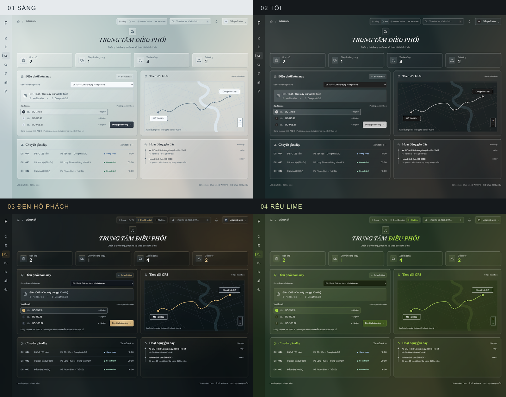

# UI chuẩn Fleet Autopilot

Kho chuẩn: [Minh1402-lap/UI_fleetautopilot](https://github.com/Minh1402-lap/UI_fleetautopilot).

Xem trực tiếp: [Fleet Autopilot](https://minh1402-lap.github.io/UI_fleetautopilot/).

Ngày chốt: **16/11/2026**. Người dùng yêu cầu tổng hợp bốn nền, lưu ảnh làm UI chuẩn và dựa vào chuẩn này khi phát triển các trang tiếp theo.

## Bộ ảnh chuẩn

| Nền | Máy tính | Điện thoại |
| --- | --- | --- |
| Sáng | [Ảnh](docs/ui-standard/2026-11-16/light-desktop.png) | [Ảnh](docs/ui-standard/2026-11-16/light-mobile.png) |
| Tối | [Ảnh](docs/ui-standard/2026-11-16/dark-desktop.png) | [Ảnh](docs/ui-standard/2026-11-16/dark-mobile.png) |
| Đen hổ phách | [Ảnh](docs/ui-standard/2026-11-16/amber-desktop.png) | [Ảnh](docs/ui-standard/2026-11-16/amber-mobile.png) |
| Rêu Lime | [Ảnh](docs/ui-standard/2026-11-16/moss-desktop.png) | [Ảnh](docs/ui-standard/2026-11-16/moss-mobile.png) |

Ảnh chụp từ giao diện đang chạy, không có CSS thử nghiệm chèn thêm. Máy tính 1600×1160px, điện thoại 390×900px; ảnh lưu toàn trang. Màn Điều phối đại diện cho lớp kính, thống kê, bảng, menu, nút và bản đồ. `manifest.json` lưu kích thước, kết quả kiểm tra và mã SHA-256 của các tệp nguồn tại thời điểm chốt. Giữ nguyên bộ ảnh ngày này làm mốc; nếu có phiên bản mới được duyệt, tạo thư mục ngày/phiên bản mới.

## Cách tiếp tục làm trang

1. Đọc tài liệu này trước khi sửa UI. Nếu đang làm trong workspace dự án đầy đủ, đọc thêm `PROJECT_CONTEXT.md` ở thư mục cha. Khi người dùng yêu cầu làm thêm trang UI cho Fleet Autopilot, mặc định kế thừa chuẩn này.
2. Dùng cấu trúc ứng dụng hiện tại trong `index.html`, `workspace.js`, `workspace.css`; giữ sidebar, thanh đầu trang, cách điều hướng và bố cục đáp ứng. Trang mới phải hỗ trợ đủ bốn nền.
3. Tái sử dụng biến màu và thành phần của `styles.css`, `amber.css`, `moss.css`, `assignment.css`, `translucent.css`, `workspace.css`, `amber-premium.css`; giữ thứ tự nạp trong `index.html`. Không chép màu cố định riêng vào từng trang.
4. Font tiêu đề trang: Newsreader 600 Italic, IN HOA. Tiêu đề khối: Newsreader 600 chữ đứng. Nội dung, điều hướng, bảng, mã đơn, biển số, biểu mẫu, số liệu: Be Vietnam Pro. Giữ kích thước và khoảng cách của các thành phần hiện có.
5. Giữ lớp kính trong mờ, mép kính mảnh 2px, phản sáng nhẹ và nền phủ toàn màn hình. Đen hổ phách dùng mẫu đen sâu/champagne trong `amber-premium.css`; không dùng lại phương án nâu vàng phủ đậm đã bị từ chối.
6. Trạng thái dùng chấm và chữ có màu, kèm khung cùng màu và nền màu nhẹ theo mẫu được duyệt ngày 17/11/2026: đang chạy xanh dương, hoàn thành/đã duyệt xanh lá, chờ xử lý vàng, đã hủy/mất tín hiệu đỏ. Dùng chung `status-badges.css` cho mọi vai trò; bo góc 6px, viền 1px, nền màu 10%, viền màu 45%. Không dùng màu giao diện để thay màu trạng thái nghiệp vụ.
7. Menu máy tính thu gọn thành biểu tượng, mở rộng khi hover/focus; thiết bị cảm ứng giữ nhãn dễ đọc. Kiểm tra trang mới trên máy tính và điện thoại, không tràn ngang và không lỗi JavaScript.
8. Nếu muốn đổi ngôn ngữ thiết kế, font, bảng màu hoặc hiệu ứng: dựng ảnh riêng để người dùng xem trước, chỉ áp dụng khi được chọn. Không coi ảnh trong `review/UI/` là chuẩn được duyệt; bộ ảnh trong tài liệu này là mốc chính thức cho công việc UI tiếp theo.

## Phạm vi chốt

Đã chốt **hình thức UI và bốn nền để phát triển tiếp**. Ứng dụng vẫn dùng dữ liệu mẫu; nghiệp vụ, backend, AI, GPS thực tế và quyền chưa được chốt bởi quyết định này. Chưa chuyển vào thư mục hoặc bản phát hành Final; chỉ làm vậy khi người dùng yêu cầu rõ.
